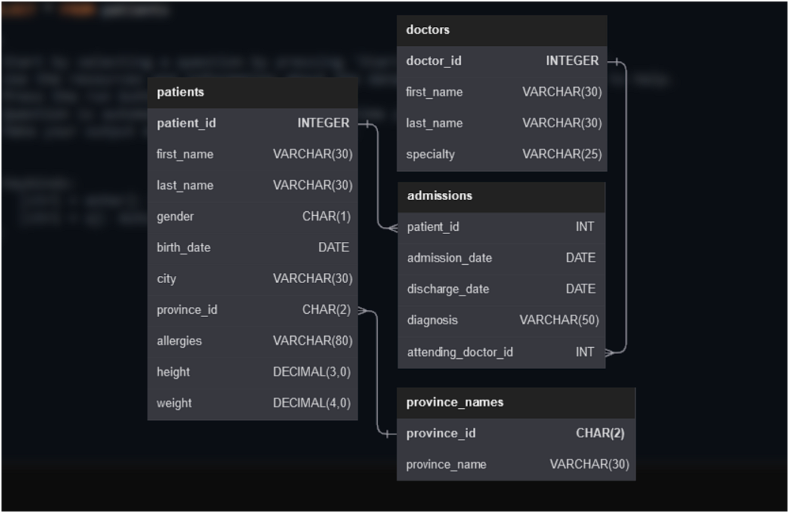
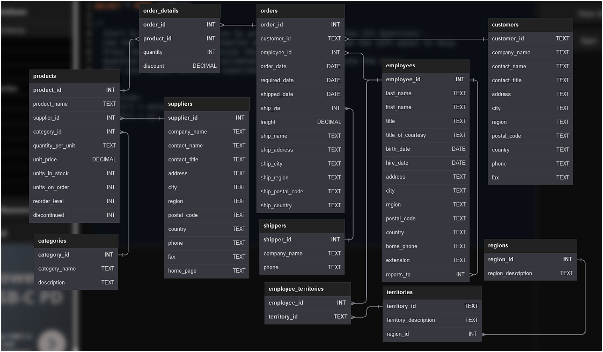

# 🗄️ SQL Practice

**130 SQL solutions from LeetCode, HackerRank and SQL-Practice, from basic SELECTs to window functions.**

---

## 📑 Table of Contents

- [About](#-about)
- [Concepts Covered](#-concepts-covered)
- [Database Schemas](#-database-schemas)
- [LeetCode](#-leetcode-61)
- [HackerRank](#-hackerrank-45)
- [SQL-Practice: Hospital Database](#-sql-practice-hospital-database-24)
- [Learning Path](#-learning-path)
- [Author](#-author)

---

## 🌟 About

This repository collects my SQL solutions from three platforms:

| Platform | Solutions | Style |
|---|:---:|---|
| **LeetCode** (Database) | 61 | Interview-style problems, many using joins and window functions |
| **HackerRank** (SQL) | 45 | From basic selects to aggregations and advanced queries |
| **SQL-Practice** (Hospital) | 24 | Queries on a hospital database (patients, admissions, doctors) |

Each file holds one solution and is named after the problem.

---

## 🧠 Concepts Covered

- **Basics:** `SELECT`, `WHERE`, `ORDER BY`, `LIMIT`, `DISTINCT`
- **Aggregation:** `COUNT`, `SUM`, `AVG`, `MIN`, `MAX`, `GROUP BY`, `HAVING`
- **Joins:** `INNER`, `LEFT`, self joins, `CROSS JOIN`
- **Subqueries & CTEs**
- **Window functions:** `ROW_NUMBER`, `RANK`, `DENSE_RANK`
- **Conditional logic:** `CASE WHEN`, `IF`, `COALESCE`
- **String & date functions**
- **Data changes:** `UPDATE`, `DELETE`

---

## 🏥 Database Schemas

### Hospital database (SQL-Practice)

Patients, admissions, doctors and province names, used by the SQL-Practice solutions.

### Northwind database

The classic Northwind sample (products, orders, customers, suppliers, employees), included as a schema for extra practice.

---

## 🟧 LeetCode (61)

<b>Show all LeetCode solutions</b>

| # | Problem | Solution |
|---:|---|:---:|
| 176 | Second Highest Salary | [SQL](176.%20Second%20Highest%20Salary.sql) |
| 180 | Consecutive Numbers | [SQL](180.%20Consecutive%20Numbers.sql) |
| 185 | Department Top Three Salaries | [SQL](185.%20Department%20Top%20Three%20Salaries.sql) |
| 196 | Delete Duplicate Emails | [SQL](196.%20Delete%20Duplicate%20Emails.sql) |
| 197 | Rising Temperature | [SQL](197.%20Rising%20Temperature.sql) |
| 550 | Game Play Analysis IV | [SQL](550.%20Game%20Play%20Analysis%20IV.sql) |
| 570 | Managers with at Least 5 Direct Reports | [SQL](570.%20Managers%20with%20at%20Least%205%20Direct%20Reports.sql) |
| 577 | Employee Bonus | [SQL](577.%20Employee%20Bonus.sql) |
| 584 | Find Customer Referee | [SQL](584.%20Find%20Customer%20Referee.sql) |
| 585 | Investments in 2016 | [SQL](585.%20Investments%20in%202016.sql) |
| 595 | Big Countries | [SQL](595.%20Big%20Countries.sql) |
| 596 | Classes With at Least 5 Students | [SQL](596.%20Classes%20With%20at%20Least%205%20Students.sql) |
| 601 | Human Traffic of Stadium | [SQL](601.%20Human%20Traffic%20of%20Stadium.sql) |
| 602 | Friend Requests II | [SQL](602.%20Friend%20Requests%20II.sql) |
| 607 | Sales Person | [SQL](607.%20Sales%20Person.sql) |
| 608 | Tree Node | [SQL](608.%20Tree%20Node.sql) |
| 619 | Biggest Single Number | [SQL](619.%20Biggest%20Single%20Number.sql) |
| 620 | Not Boring Movies | [SQL](620.%20Not%20Boring%20Movies.sql) |
| 626 | Exchange Seats | [SQL](626.%20Exchange%20Seats.sql) |
| 627 | Swap Salary | [SQL](627.%20Swap%20Salary.sql) |
| 1045 | Customers Who Bought All Products | [SQL](1045.%20Customers%20Who%20Bought%20All%20Products.sql) |
| 1050 | Actors and Directors Who Cooperated At Least Three Times | [SQL](1050.%20Actors%20and%20Directors%20Who%20Cooperated%20At%20Least%20Three%20Times.sql) |
| 1068 | Product Sales Analysis I | [SQL](1068.%20Product%20Sales%20Analysis%20I.sql) |
| 1070 | Product Sales Analysis III | [SQL](1070.%20Product%20Sales%20Analysis%20III.sql) |
| 1075 | Project Employees I | [SQL](1075.%20Project%20Employees%20I.sql) |
| 1141 | User Activity for the Past 30 Days I | [SQL](1141.%20User%20Activity%20for%20the%20Past%2030%20Days%20I.sql) |
| 1148 | Article Views I | [SQL](1148.%20Article%20Views%20I.sql) |
| 1158 | Market Analysis I | [SQL](1158.%20Market%20Analysis%20I.sql) |
| 1164 | Product Price at a Given Date | [SQL](1164.%20Product%20Price%20at%20a%20Given%20Date.sql) |
| 1174 | Immediate Food Delivery II | [SQL](1174.%20Immediate%20Food%20Delivery%20II.sql) |
| 1179 | Reformat Department Table | [SQL](1179.%20Reformat%20Department%20Table.sql) |
| 1193 | Monthly Transactions I | [SQL](1193.%20Monthly%20Transactions%20I.sql) |
| 1204 | Last Person to Fit in the Bus | [SQL](1204.%20Last%20Person%20to%20Fit%20in%20the%20Bus.sql) |
| 1211 | Queries Quality and Percentage | [SQL](1211.%20Queries%20Quality%20and%20Percentage.sql) |
| 1251 | Average Selling Price | [SQL](1251.%20Average%20Selling%20Price.sql) |
| 1280 | Students and Examinations | [SQL](1280.%20Students%20and%20Examinations.sql) |
| 1321 | Restaurant Growth | [SQL](1321.%20Restaurant%20Growth.sql) |
| 1327 | List the Products Ordered in a Period | [SQL](1327.%20List%20the%20Products%20Ordered%20in%20a%20Period.sql) |
| 1341 | Movie Rating | [SQL](1341.%20Movie%20Rating.sql) |
| 1378 | Replace Employee ID With The Unique Identifier | [SQL](1378.%20Replace%20Employee%20ID%20With%20The%20Unique%20Identifier.sql) |
| 1407 | Top Travellers | [SQL](1407.%20Top%20Travellers.sql) |
| 1484 | Group Sold Products By The Date | [SQL](1484.%20Group%20Sold%20Products%20By%20The%20Date.sql) |
| 1517 | Find Users With Valid E-Mails | [SQL](1517.%20Find%20Users%20With%20Valid%20E-Mails.sql) |
| 1527 | Patients With a Condition | [SQL](1527.%20Patients%20With%20a%20Condition.sql) |
| 1581 | Customer Who Visited but Did Not Make Any Transactions | [SQL](1581.%20Customer%20Who%20Visited%20but%20Did%20Not%20Make%20Any%20Transactions.sql) |
| 1587 | Bank Account Summary II | [SQL](1587.%20Bank%20Account%20Summary%20II.sql) |
| 1633 | Percentage of Users Attended a Contest | [SQL](1633.%20Percentage%20of%20Users%20Attended%20a%20Contest.sql) |
| 1661 | Average Time of Process per Machine | [SQL](1661.%20Average%20Time%20of%20Process%20per%20Machine.sql) |
| 1667 | Fix Names in a Table | [SQL](1667.%20Fix%20Names%20in%20a%20Table.sql) |
| 1683 | Invalid Tweets | [SQL](1683.%20Invalid%20Tweets.sql) |
| 1729 | Find Followers Count | [SQL](1729.%20Find%20Followers%20Count.sql) |
| 1731 | The Number of Employees Which Report to Each Employee | [SQL](1731.%20The%20Number%20of%20Employees%20Which%20Report%20to%20Each%20Employee.sql) |
| 1757 | Recyclable and Low Fat Products | [SQL](1757.%20Recyclable%20and%20Low%20Fat%20Products.sql) |
| 1789 | Primary Department for Each Employee | [SQL](1789.%20Primary%20Department%20for%20Each%20Employee.sql) |
| 1795 | Rearrange Products Table | [SQL](1795.%20Rearrange%20Products%20Table.sql) |
| 1890 | The Latest Login in 2020 | [SQL](1890.%20The%20Latest%20Login%20in%202020.sql) |
| 1907 | Count Salary Categories | [SQL](1907.%20Count%20Salary%20Categories.sql) |
| 1934 | Confirmation Rate | [SQL](1934.%20Confirmation%20Rate.sql) |
| 1965 | Employees With Missing Information | [SQL](1965.%20Employees%20With%20Missing%20Information.sql) |
| 1978 | Employees Whose Manager Left the Company | [SQL](1978.%20Employees%20Whose%20Manager%20Left%20the%20Company.sql) |
| 3497 | Analyze Subscription Conversion | [SQL](3497.%20Analyze%20Subscription%20Conversion%20.sql) |

---

## 🟩 HackerRank (45)

<b>Show all HackerRank solutions</b>

| # | Problem | Solution |
|---:|---|:---:|
| 1 | African Cities | [SQL](African%20Cities.sql) |
| 2 | Average Population | [SQL](Average%20Population.sql) |
| 3 | Average Population of Each Continent | [SQL](Average%20Population%20of%20Each%20Continent.sql) |
| 4 | Binary Tree Nodes | [SQL](Binary%20Tree%20Nodes.sql) |
| 5 | Draw The Triangle 1 | [SQL](Draw%20The%20Triangle%201.sql) |
| 6 | Draw The Triangle 2 | [SQL](Draw%20The%20Triangle%202.sql) |
| 7 | Employee Names | [SQL](Employee%20Names.sql) |
| 8 | Employee Salaries | [SQL](Employee%20Salaries.sql) |
| 9 | Higher Than 75 Marks | [SQL](Higher%20Than%2075%20Marks.sql) |
| 10 | Japan Population | [SQL](Japan%20Population.sql) |
| 11 | Japanese Cities' Attributes | [SQL](Japanese%20Cities'%20Attributes.sql) |
| 12 | Loss | [SQL](Loss.sql) |
| 13 | New Companies | [SQL](New%20Companies.sql) |
| 14 | Population Census | [SQL](Population%20Census.sql) |
| 15 | Population Density Difference | [SQL](Population%20Density%20Difference.sql) |
| 16 | Print Prime Numbers | [SQL](Print%20Prime%20Numbers.sql) |
| 17 | Revising Aggregations - Averages | [SQL](Revising%20Aggregations%20-%20Averages.sql) |
| 18 | Revising Aggregations - The Count Function | [SQL](Revising%20Aggregations%20-%20The%20Count%20Function.sql) |
| 19 | Revising Aggregations - The Sum Function | [SQL](Revising%20Aggregations%20-%20The%20Sum%20Function.sql) |
| 20 | Revising the Select Query I | [SQL](Revising%20the%20Select%20Query%20I.sql) |
| 21 | Revising the Select Query II | [SQL](Revising%20the%20Select%20Query%20II.sql) |
| 22 | Select All | [SQL](Select%20All.sql) |
| 23 | Select By ID | [SQL](Select%20By%20ID.sql) |
| 24 | The Blunder | [SQL](The%20Blunder.sql) |
| 25 | Top Earners | [SQL](Top%20Earners.sql) |
| 26 | Type of Triangle | [SQL](Type%20of%20Triangle.sql) |
| 27 | Weather Observation Station 1 | [SQL](Weather%20Observation%20Station%201.sql) |
| 28 | Weather Observation Station 2 | [SQL](Weather%20Observation%20Station%202.sql) |
| 29 | Weather Observation Station 3 | [SQL](Weather%20Observation%20Station%203.sql) |
| 30 | Weather Observation Station 4 | [SQL](Weather%20Observation%20Station%204.sql) |
| 31 | Weather Observation Station 5 | [SQL](Weather%20Observation%20Station%205.sql) |
| 32 | Weather Observation Station 6 | [SQL](Weather%20Observation%20Station%206.sql) |
| 33 | Weather Observation Station 7 | [SQL](Weather%20Observation%20Station%207.sql) |
| 34 | Weather Observation Station 8 | [SQL](Weather%20Observation%20Station%208.sql) |
| 35 | Weather Observation Station 9 | [SQL](Weather%20Observation%20Station%209.sql) |
| 36 | Weather Observation Station 10 | [SQL](Weather%20Observation%20Station%2010.sql) |
| 37 | Weather Observation Station 11 | [SQL](Weather%20Observation%20Station%2011.sql) |
| 38 | Weather Observation Station 12 | [SQL](Weather%20Observation%20Station%2012.sql) |
| 39 | Weather Observation Station 13 | [SQL](Weather%20Observation%20Station%2013.sql) |
| 40 | Weather Observation Station 14 | [SQL](Weather%20Observation%20Station%2014.sql) |
| 41 | Weather Observation Station 15 | [SQL](Weather%20Observation%20Station%2015.sql) |
| 42 | Weather Observation Station 16 | [SQL](Weather%20Observation%20Station%2016.sql) |
| 43 | Weather Observation Station 17 | [SQL](Weather%20Observation%20Station%2017.sql) |
| 44 | Weather Observation Station 18 | [SQL](Weather%20Observation%20Station%2018.sql) |
| 45 | Weather Observation Station 19 | [SQL](Weather%20Observation%20Station%2019.sql) |

---

## 🟪 SQL-Practice: Hospital Database (24)

<b>Show all SQL-Practice solutions</b>

| # | Problem | Solution |
|---:|---|:---:|
| 1 | Admissions count patient 579 | [SQL](admissions_count_patient_579.sql) |
| 2 | Dementia patients | [SQL](dementia_patients.sql) |
| 3 | Full patient name | [SQL](full_patient_name.sql) |
| 4 | Gender counts | [SQL](gender_counts.sql) |
| 5 | Get male patients | [SQL](get_male_patients.sql) |
| 6 | Hamilton allergies | [SQL](hamilton_allergies.sql) |
| 7 | Highest patient details | [SQL](highest_patient_details.sql) |
| 8 | Multiple diagnosis admissions | [SQL](multiple_diagnosis_admissions.sql) |
| 9 | Ordered first names | [SQL](ordered_first_names.sql) |
| 10 | Patient province names | [SQL](patient_province_names.sql) |
| 11 | Patients born in 2010 | [SQL](patients_born_in_2010.sql) |
| 12 | Patients starting with c | [SQL](patients_starting_with_c.sql) |
| 13 | Patients weight range | [SQL](patients_weight_range.sql) |
| 14 | Patients without allergies | [SQL](patients_without_allergies.sql) |
| 15 | Penicillin morphine allergies | [SQL](penicillin_morphine_allergies.sql) |
| 16 | S name patients | [SQL](s_name_patients.sql) |
| 17 | Same day admissions | [SQL](same_day_admissions.sql) |
| 18 | Selected patient ids | [SQL](selected_patient_ids.sql) |
| 19 | Tall heavy patients | [SQL](tall_heavy_patients.sql) |
| 20 | Tallest patient | [SQL](tallest_patient.sql) |
| 21 | Total admissions | [SQL](total_admissions.sql) |
| 22 | Unique birth years | [SQL](unique_birth_years.sql) |
| 23 | Unique ns cities | [SQL](unique_ns_cities.sql) |
| 24 | Unique single first names | [SQL](unique_single_first_names.sql) |

---

## 🎯 Learning Path

| Level | Focus |
|---|---|
| 🟢 **Beginner** | Basic `SELECT`, filtering with `WHERE`, simple aggregates (HackerRank *Revising the Select Query*, *Weather Observation Station*) |
| 🟡 **Intermediate** | Joins, `GROUP BY` + `HAVING`, subqueries (LeetCode 570, 1075, 1280) |
| 🔴 **Advanced** | Window functions, CTEs, consecutive and running totals (LeetCode 180, 185, 601, 1321) |

---

## 🔗 Resources

- [LeetCode Database Problems](https://leetcode.com/problemset/database/)
- [HackerRank SQL Track](https://www.hackerrank.com/domains/sql)
- [SQL-Practice](https://www.sql-practice.com/)

---

## 👨‍💻 Author

**Ahmed Ramzy**

⭐ If you find this useful, give it a star!

